# WHAT_WE_DID — Sanjivani

> Living document, updated alongside the code (not written from memory).
> Every claim below is verifiable in the repository.

## 1. Project overview

**Pitch:** Sanjivani is a one-stop open-source platform that replaces Excel, WhatsApp, and
physical notices with a single system for NGOs to manage campaigns, teams (staff +
volunteers), communication, and fund tracking — while volunteers build a verified, portable
history of their community work.

**Actors**

| Actor | What they do on the platform |
|---|---|
| **Admin** | Approves/verifies NGOs and volunteers, reviews volunteer reports, suspends/unsuspends accounts, watches platform stats |
| **NGO** | Creates campaigns, invites/manages staff, manages teams, creates chat rooms with chosen participants, allocates funds, rates volunteers, reports misconduct |
| **Staff** | Claimed via NGO invite (no public signup); assigned to campaign teams, participates in chat rooms scoped to the inviting NGO |
| **Volunteer** | Applies to campaigns or responds to invitations, joins teams, chats, builds history, rates NGOs; earns a verified badge via admin approval |

## 2. Actual features implemented

Checklist against the spec (§ = Sanjivani_Spec.md section):

- [x] Supabase project schema — 16 tables via `supabase/migrations/` (§7/§17)
- [x] Email confirmation disabled; signup logs in immediately (§6, documented in README)
- [x] RLS enabled on **every** table with the §9 policies (incl. suspension checks)
- [x] Auth: role-aware signup (NGO/Volunteer + staff-invite claim), login, logout,
      session persistence, `proxy.ts` route guards (§6, Next 16's renamed middleware convention)
- [x] NGO signup → `ngos` row `pending`; campaign creation blocked until approved
      (UI gate in the proxy + RLS insert policy) (§6)
- [x] Admin dashboard: pending NGO queue with approve/reject (§8 routes)
- [x] Admin platform oversight: full directories of every NGO, campaign, staff
      member, and volunteer on one dashboard (tabbed) — with inline
      approve/reject, verify/reject, and suspend/unsuspend on every row, no
      report required; campaign rows show owner, status, type, dates, team
      size, applications, and budget utilisation (enough to keep operations in
      check without exposing ledgers/chat); suspended owners are flagged
- [x] Admin NGO detail page: campaign overview enriched with team size,
      applications count, and budget use; staff roster with claim state and
      per-account suspend actions
- [x] Volunteer verification: pending → approved/rejected → verified badge; core
      features usable while pending (§6)
- [x] Volunteer verified badge + admin approval queue on the dashboard
- [x] NGO report volunteer (shared-campaign guard in RLS) + admin review queue
      (open → reviewed/dismissed)
- [x] NGO staff invite by name+email; invite shows `invited` until claimed; email
      auto-detection on the signup form; remove staff cleans team/chat memberships
- [x] Signup with invited email creates a `staff` profile + flips `ngo_staff` to
      `active`; `/staff/accept-invite` lets existing accounts claim explicitly
- [x] Active staff assignable to campaign teams; staff dashboard scoped to the NGO
- [x] Campaign CRUD (create/edit/delete) + status lifecycle
      (upcoming → ongoing → completed / cancelled)
- [x] Campaign validation: end ≥ start, budget ≥ 0 (Zod + DB triggers)
- [x] Public browse + text search (title/location/NGO); invite-only campaigns hidden
- [x] Volunteer applications; NGO accept/reject; duplicate-application guard (DB)
- [x] Teams + member assignment with staff/volunteer eligibility triggers
- [x] Chat rooms per campaign: name room + multi-select team members; non-selected
      team members cannot see the room (RLS) (§5)
- [x] Realtime messages scoped to room members (Supabase Realtime + RLS)
- [x] Invite-only campaigns: NGO invites volunteers; accept creates an `accepted`
      application directly; decline marks the invite declined
- [x] Fund ledger: allocate (≤ remaining), mark paid, remove; `remaining_budget`
      invariant maintained by trigger — can never go negative
- [x] Notifications for all 7 trigger events (application status, campaign invite,
      team assignment, fund allocation, new chat message, NGO approval/rejection,
      staff invite) — implemented as SECURITY DEFINER triggers + realtime panel
- [x] Campaign `completed` unlocks ratings UI and hours logging
- [x] NGO dashboard: pending applications queue, live stats, and a “reports you
      filed” card tracking the review status of the NGO's volunteer reports
- [x] Bidirectional ratings (1–5 + comment) with eligibility triggers; `avg_rating`
      recomputed automatically on both `ngos` and `volunteers`; the campaign's
      NGO owner counts as a rating participant (volunteer ⇄ NGO, both ways)
- [x] Volunteer auto-history: campaigns joined, hours sum (`volunteer_total_hours`
      RPC), average rating, ratings list
- [x] Hours logging (`hours_logged`) only after completion, NGO-only (trigger)
- [x] Suspension: admin suspend/unsuspend; blocked at the proxy layer (redirect to
      `/suspended`) and RLS (writes rejected); data preserved
- [x] Suspension takes down the NGO's public operation: a suspended NGO's
      campaigns disappear from volunteer browse and their detail pages 404 for
      non-members (RLS policy + app-level guard); new applications to their
      campaigns are rejected; unsuspend restores everything
- [x] Notifications for all 7 spec trigger events plus end-to-end coverage:
      new application → NGO, campaign status change → every team member
      (completion announces open ratings), rating received, hours logged,
      report filed → admins, report reviewed/dismissed → reporting NGO,
      campaign invite declined → NGO, team removal → member, and
      suspension/unsuspension → the account
- [x] CSV export of team + fund summary (§8 POST `/api/export/[campaignId]`)
- [x] All forms validate client + server with Zod (§12) + DB-level guards
- [x] SVG logo (leaf/S mark) used in navbar, favicon (`app/icon.svg`), landing hero;
      PNG app icon generated from the same SVG
- [x] Dark + light mode: `theme` in localStorage, `dark` class on `<html>`, system
      default via `prefers-color-scheme`, no-flash bootstrap, toggle in every navbar
- [x] Profile pictures: avatars / NGO logos / campaign images upload from every form
      (Supabase Storage live; browser-resized data URLs in demo) and display across
      navbar, chat, rosters, cards, and profiles; seeded media included
- [x] Demo mode as a separate opt-in runtime (`npm run demo`, NEXT_PUBLIC_DEMO_MODE=1) —
      a deliberately **basic, ephemeral** in-memory backend for clicking around without
      Supabase; normal dev/production requires Supabase env or shows `/setup`
- [x] Loading skeletons on all four role dashboards (§11)
- [x] `.env.example` present; no secrets committed
- [x] `supabase/seed.sql` demo dataset (all actors + 4 campaigns + flows)
- [x] README with setup steps + demo credentials
- [x] Vitest unit/component tests: validation rules, fund arithmetic, rating
      eligibility, formatting/CSV helpers, RatingForm component, and demo-engine
      smoke tests (query mechanics, insert defaults, the two live aggregates)
- [x] Playwright E2E specs for all 10 critical flows (§19) + 3 server-action
  resilience regressions (stale session / role swap / suspension) — all green against
      the demo server (`npm run test:e2e` boots it automatically)
- [x] Supabase Storage bucket + policies (images ≤ 2 MB, image types only, own folder)

**Descoped / not applicable in this environment**

- [ ] Live Vercel deployment + hosted Supabase — the code is deployment-ready and the
      README documents the exact steps; deployment requires the team's accounts.
- [ ] E2E execution in CI — specs are complete and runnable locally
      (`supabase db reset && npm run test:e2e`); no CI pipeline was set up.

## 3. UML use case diagram

```mermaid
flowchart LR
    subgraph SanjivaniPlatform["Sanjivani"]
        UC1((Approve/Reject NGO))
        UC2((Approve/Reject Volunteer))
        UC3((Review Volunteer Report))
        UC4((Suspend / Unsuspend Account))
        UC5((View Platform Stats))
        UC6((Create Campaign))
        UC7((Invite Volunteer to Invite-only Campaign))
        UC8((Invite Staff))
        UC9((Manage Team))
        UC10((Log Volunteer Hours))
        UC11((Create Chat Room))
        UC12((Allocate Funds))
        UC13((Rate Volunteer))
        UC14((Report Volunteer))
        UC15((View Applications))
        UC16((Accept Staff Invite))
        UC17((Join Team - assigned by NGO))
        UC18((Participate in Chat Room))
        UC19((Apply to Campaign))
        UC20((Respond to Campaign Invite))
        UC21((Rate NGO))
        UC22((View Verified History))
    end

    Admin((Admin))
    NGO((NGO))
    Staff((Staff))
    Volunteer((Volunteer))

    Admin --- UC1 & UC2 & UC3 & UC4 & UC5
    NGO --- UC6 & UC7 & UC8 & UC9 & UC10 & UC11 & UC12 & UC13 & UC14 & UC15
    Staff --- UC16 & UC17 & UC18
    Volunteer --- UC19 & UC20 & UC17 & UC18 & UC21 & UC22
```

## 4. Database schema (as deployed)

16 tables in `supabase/migrations/00001_schema.sql` (+ `00002…00007` for functions,
RLS, triggers, realtime/storage, stats RPC, and the oversight hardening):

| Table | Purpose | Key relations |
|---|---|---|
| `profiles` | One row per auth user (role: admin/ngo/volunteer/staff, suspended) | id → auth.users |
| `ngos` | NGO record + verification status, avg rating | profile_id → profiles |
| `volunteers` | Skills/interests/availability, verification, avg rating | profile_id → profiles |
| `ngo_staff` | Staff invites (invited → active) | ngo_id → ngos, profile_id → profiles |
| `campaigns` | Campaign fields + type/status + budgets | ngo_id → ngos |
| `volunteer_reports` | NGO-filed misconduct reports | volunteer/reported_by → profiles, campaign_id → campaigns |
| `teams` | Named team within a campaign | campaign_id → campaigns |
| `team_members` | Staff/volunteer memberships + hours_logged | team_id → teams, user_id → profiles |
| `applications` | Volunteer applications (pending/accepted/rejected) | volunteer_id, campaign_id |
| `campaign_invites` | Invite-only campaign invitations | campaign_id, volunteer_id, invited_by |
| `fund_allocations` | Amount per member with pending/paid status | campaign_id, member_id |
| `chat_rooms` | Named room per campaign | campaign_id → campaigns, created_by |
| `chat_room_members` | Who can see which room | room_id, user_id |
| `messages` | Room messages (1–2000 chars) | room_id, sender_id |
| `notifications` | In-app notifications (20 trigger types) | user_id |
| `ratings` | Bidirectional 1–5 ratings post-completion | campaign_id, from/to users |

**Business rules enforced in the database** (triggers):
duplicate applications, invite-only application path, campaign date/budget sanity,
fund amount ≤ remaining + automatic `remaining_budget` sync (never negative),
team member eligibility (active staff / accepted volunteers), chat room members must
be on the campaign team, rating eligibility (completed + shared team/NGO owner + no
self/dup) + `avg_rating` recomputation, hours only after completion, role/suspension/
verification column guards, and all 20 notification events (the 7 spec events + end-to-end coverage). `00007_oversight.sql`
additionally takes down a suspended NGO's public operation (campaigns hidden from
everyone but admins, the owner, and existing team members) and restricts application
inserts to genuinely joinable campaigns.

## 5. API / routes summary

Next.js route handlers (spec §8) — all return `{ success, data }` / `{ success, error }`:

| Method | Route | Access |
|---|---|---|
| POST | `/api/auth/signup` | Public (role-aware bootstrap, staff claim) |
| POST | `/api/auth/check-invite` | Public (staff invite email detection) |
| POST | `/api/admin/approve-ngo` | Admin |
| POST | `/api/admin/reject-ngo` | Admin |
| POST | `/api/admin/approve-volunteer` | Admin |
| POST | `/api/admin/reject-volunteer` | Admin |
| POST | `/api/admin/suspend` | Admin |
| POST | `/api/admin/unsuspend` | Admin |
| POST | `/api/reports/volunteer` | NGO (shared campaign) |
| POST | `/api/ngo/staff/invite` | NGO |
| DELETE | `/api/ngo/staff/[id]` | NGO owner |
| POST | `/api/chat/rooms` | NGO owner |
| PATCH/DELETE | `/api/chat/rooms/[id]` | NGO owner (rename/delete) |
| POST | `/api/chat/rooms/[id]/members` | NGO owner (add/remove) |
| GET | `/api/campaigns/[id]/invites` | NGO owner (volunteer search) |
| POST | `/api/campaigns/[id]/invites` | NGO owner |
| POST | `/api/campaigns/[id]/invites/[inviteId]/respond` | Invited volunteer |
| POST | `/api/export/[campaignId]` | NGO owner (CSV) |
| POST | `/api/notify` | Internal (service-role bearer) |

Everything else (campaign CRUD, applications, teams, hours, funds, ratings, profiles)
runs through server actions under the user's Supabase session with RLS enforcement.

## 6. Demo mode — the whole product without Supabase (basic + ephemeral)

The app can boot into a **basic in-memory backend** when explicitly asked for it
(`npm run demo`, i.e. `NEXT_PUBLIC_DEMO_MODE=1`); `lib/demo/` implements it:

- `store.ts` seeds the same dataset as `supabase/seed.sql` (12 accounts, 4 campaigns,
  teams, chat, funds, ratings, report, notifications) onto `globalThis` — the store is
  **ephemeral**: it lives in the server process and resets on every restart.
- `engine.ts` is a small PostgREST-compatible executor: filters (`eq/neq/in/ilike/is/or`),
  ordering, `limit`, `single/maybeSingle`, exact counts, FK embed resolution
  (`sender:sender_id(…)`, `rooms!inner(…)`, nested `ngo:ngos!fkey(…)`), and
  insert/update/delete with the column defaults the app relies on. The only maintained
  aggregates are the two numbers the UI displays live (`remaining_budget`, `avg_rating`).
  It deliberately does **not** emulate the Postgres triggers — business rules and
  notification fan-out only exist in a real Supabase deployment; demo writes are
  permissive and the bell shows the seeded notifications.
- `client.ts` builds the fluent supabase-js-shaped builder; in the browser it serialises
  each operation and POSTs it to `/api/demo`, so every tab shares the one server store.
- Demo auth is a cookie session (`sv-demo-user`) validated against the seeded users;
  the login screen lists every account with one-click fill (password `Passw0rd!`).
- Realtime falls back to polling (chat 4s, notifications 5s); image uploads are resized
  in the browser and kept as data URLs in the seeded store, so avatars/logos/campaign
  images round-trip exactly like they do against Supabase Storage.
- Demo mode is **opt-in and separate from deployment**. A plain `npm run dev`/
  `npm start` connects to real Supabase when env vars exist, and otherwise shows a
  `/setup` screen with configuration instructions — production never silently serves
  seed data.

## 7. UI — Sanjivani green design system (spec §3)

The interface follows the visual identity defined in `Sanjivani_Spec.md` §3, executed
with a dynamic, patterned layout:

- **Palette**: warm green `#2E7D32` primary with the `#E8F5E9` surface tint and
  `#66BB6A` bright accent; clean, card-based layout, `rounded-xl` corners, soft warm
  shadows, generous whitespace — welcoming for non-technical NGO staff.
- **Dark + light mode**: a single `theme` key in `localStorage` toggles a `dark` class
  on `<html>`, defaulting to `prefers-color-scheme`; applied pre-paint (no flash) via a
  bootstrap script in `app/layout.tsx`, with a sun/moon toggle in every navbar.
- **Patterns (botanical, token-driven)**: hairline grid, leaf-dot lattice, growth
  rings, soft green wash, and seedling strips — layered on the landing hero, stats
  band, feature cards, and auth screens; all recede further in dark mode.
- **Type**: Alumni Sans display (hero/section heads), Albert Sans body/UI, system mono
  for tracked eyebrows/labels — bundled locally as woff2 (zero network fonts).
- **Brand mark**: the Sanjivani **leaf-S** — two layered leaves (deep green NGO arm +
  bright green volunteer arm) forming one continuous growth path, readable at 24px,
  clean at 512px; shipped as `public/logo.svg`, favicon `app/icon.svg`, and a 512px
  app-icon PNG, with midrib-vein detail in large lockups.
- **Motion (final pass — SaaS-grade, still zero JS weight)**: staggered fade-up
  entrances across hero/auth/dashboards, IntersectionObserver scroll reveals, rAF
  count-up stats, slowly drifting background patterns, a live NGO marquee (real approved
  orgs from the DB), floating leaf particles on the hero, breathing live-status dots,
  chat-bubble pop-ins, and hover lift + sheen sweep on cards/CTAs — every effect fully
  disabled under `prefers-reduced-motion`, no animation libraries.
- **Account menu**: the avatar badge opens the full profile hub — identity (photo, name,
  email, role chip), profile & photo settings, per-role workspace shortcuts, the theme
  switch, and sign out. The navbar drops its Profile link and stays task-focused.
- **Admin profile page**: `/admin/profile` gives platform admins the same name /
  location / photo editing as every other role (server action + validation, works in
  both live and demo modes).
- **Profile pictures everywhere**: avatars, NGO logos, and campaign images display in
  the navbar, chat bubbles, team rosters, applications, room pickers, campaign cards,
  browse list, and profile/admin pages (shared `UserAvatar` with initials fallback).
  Seeded accounts, NGOs, and campaigns ship with pictures (`public/demo/`), and every
  form can upload them (Supabase Storage live, browser-resized data URLs in demo).
- **Loading skeletons** (`loading.tsx`) on all four role dashboards (spec §11).
- **Motion restraint pass**: hero leaves thinned to five softer silhouettes, the closing
  brand mark no longer floats (scroll-reveal entrance only), and the Field Overview
  proof card is static after its entrance — a permanently floating card re-rasterises
  its text every frame, which reads as flicker on Windows subpixel rendering. Continuous
  motion is now only the imperceptible pattern drift, the slow NGO marquee, and the
  small “live” status dots; entrances stay under 0.6 s.
- Dependencies pruned/updated: framer-motion removed (unused), all packages at their
  latest stable majors (Next 16.4, React 19.3, Tailwind 4.3, Radix latest, lucide 1.x).
- Dependency hygiene: jsdom pinned to 29 (Node 20.19+/22.13+ engines), `@playwright/test`
  + `@types/react`/`-dom`/`-node` declared explicitly, `test:e2e`/`db:reset` scripts wired,
  and both lockfiles (npm + bun) committed with an engine-check script
  (`scripts/check-engines.mjs`).
- Lint stack rebuilt: `eslint-config-next` (whose nested eslint-plugin-import /
  eslint-plugin-jsx-a11y peers only accept eslint ≤ 9 — the source of every install-time
  peer warning) replaced with `typescript-eslint` + `eslint-plugin-react-hooks`, both
  officially eslint-10 compatible. `npm install` now completes with zero warnings and
  `npm audit` → 0 findings total (the `braces` advisory chain disappeared with
  `eslint-config-next`). `npm run lint` enforces unused-code, floating-promise and
  hooks-correctness rules and exits clean.
- Next 16 conventions: `middleware.ts` migrated to the `proxy.ts` file convention (no
  deprecation warning) and `turbopack.root` pinned in next.config.ts so stray lockfiles
  above the project directory can never confuse the dev server; `devIndicators: false`
  keeps the dev UI clean.
- Full UI/UX audit round (VLM-reviewed screenshots of every route, light + dark +
  mobile) fixed: chat message-row alignment (avatars top-aligned, consistent bubble
  x-position within a group), the detached chat character counter, a real RSC crash on
  the NGO campaign-edit tab (inline closure passed to a client component — now a bound
  server action), a cross-NGO data leak on the NGO dashboard (pending applications are
  now scoped to the NGO's own campaigns), inconsistent icons (rating / new-campaign),
  login demo-chip truncation, over-heavy empty states, dark-footer contrast, the four
  demo campaign banners regenerated as one visual family, print/PDF safety for
  scroll-reveal sections, and a rebuilt staff profile page (identity header + workspace
  card) so the route no longer looks sparse.

### Visual-consistency QA pass (final round)

A full designer-grade audit was run over screenshots of every page (all four roles,
dark mode, and 390 px mobile) with fixes applied against one written contract:

- **Semantic status colours** — the badge tone map previously referenced a legacy
  palette that no longer existed, so every `StatusBadge` rendered uncoloured. It now
  uses five semantic tokens (`status-positive / info / warning / danger / neutral`,
  with dark-mode variants) defined in `globals.css`, and every status chip in the app
  goes through the same component.
- **One stat-card rhythm** — `StatCard` guarantees equal heights inside a grid (fixed
  hint line, bottom-aligned value, `h-full`), so mixed rows (4-up dashboards, 6-up
  admin, 3-up closing stats) all share one anatomy. Labels were shortened so nothing
  truncates awkwardly.
- **One page-header pattern** — `components/PageHeader.tsx` (back link + title +
  subtitle + right-aligned action slot) is used on every page across all roles;
  orphaned bottom "Back" buttons are gone.
- **One button taxonomy** — row actions are `size="sm" variant="outline"`
  (destructive ones tinted red), page-level primaries are solid green, destructive
  confirms stay solid inside dialogs, form submits are right-aligned. The mixed
  solid/ghost/outline action rows were normalised everywhere.
- **Stable card grids** — campaign cards, workspace cards, staff/team cards and
  profile forms use `h-full` + grid stretch, fixed image aspect and `min-h` text
  blocks, so sibling cards always share baselines.
- **Consistent chat anatomy** — bubbles cap at 75 % width with a sharpened corner
  toward the sender, uniform padding, and consistent timestamp placement; the
  composer's send button matches the input's radius.
- **Uniform container widths** — profiles `max-w-3xl`, list pages `max-w-5xl`,
  campaign detail `max-w-6xl`, chat `max-w-5xl`, dashboards full width — the same
  page type is the same width for every role.
- **Mobile overflow fixed** — the volunteer dashboard (419 px) and admin dashboard
  (427 px) both overflowed a 390 px viewport; every page now measures exactly 390 px
  wide at that breakpoint, and the login submit can no longer hide under the sticky
  header after tapping a demo account.
- Verified after the pass: `tsc` clean, ESLint clean, 84/84 unit tests, 10/10 e2e
  specs, plus a re-audit of fresh screenshots (remaining VLM notes were either
  data-dependent by design, intentional semantic colouring, or full-page-screenshot
  artefacts of the scroll-reveal animation — each remaining claim was checked and
  disproven in the DOM).

### Reliability & production QA pass (ship round)

A senior-QA sweep of **every button on every page as every role** (7 sessions:
admin, 2 approved NGOs, pending NGO, staff, 2 volunteers — 48+ routes, dialogs
opened, confirms accepted, suspend clicks paired with undo) hunting for the
"invalid server request" class of failure reported on the campaign status
buttons. Findings and fixes:

- **Server actions never redirect at the middleware** (root cause of the reported
  bug). `proxy.ts` runs for action POSTs too, and a 307 redirect mangles the
  action protocol — the browser throws an opaque "invalid server request /
  unexpected response" error and the button dies silently. This hit any stale
  tab: expired session, user signed in as another role in a second tab, or the
  account getting suspended mid-browse. Both session middlewares (demo + live)
  now detect `Next-Action` POSTs and pass them through un-redirected; every
  action's own `requireXClient()` guard handles auth by redirecting *inside*
  the action, which the browser follows cleanly to `/login`, the role home, or
  `/suspended`.
- **Action guards now mirror the RLS rules** (defense in depth): volunteer
  actions reject suspended users; NGO campaign/team/fund/rating writes require
  an approved NGO (`requireApprovedNgoClient` — pending NGOs keep the dashboard
  + profile); `setCampaignStatus` validates the status enum.
- **No silent dead buttons**: every client-side server-action call goes through
  `lib/client-action.ts` (`runServerAction`), which converts transport failures
  (network drop, stale action manifest, unexpected 500) into a friendly
  `{ ok: false }` result so the existing toast branches always fire. A global
  `unhandledrejection` safety net (`components/RejectionSafetyNet.tsx`,
  rate-limited) catches anything a future component might miss.
- **Complete friendly-error map**: `friendlyDbError` learned every trigger/demo
  engine code (NGO_SUSPENDED, FUND_TARGET_IMMUTABLE, INVITE_TARGET_IMMUTABLE,
  RATING_SCORE_RANGE, ROOM_NOT_FOUND, …), so users see sentences, never codes.
- **Consistent invite acceptance**: the respond route rolls the invite back to
  pending if the companion application insert fails, so an invite can never end
  up "accepted" without the team-eligibility it implies.
- **Cross-platform scripts, simple deploy path**: `npm run dev/build/start` are plain
  `next` commands (no `tee`, `cp -r`, env prefixes, or bun — identical on macOS, Linux,
  and Windows); the standalone-output build step was dropped in favour of the standard
  `next build` + `next start` pair Vercel expects, and `npm run test:e2e` boots the demo
  server itself so the suite runs anywhere with zero prerequisites.
- **Why testing missed it**: every e2e spec clicked with a fresh, valid session
  immediately after page load; the broken path needs a *stale* tab. New spec
  `tests/e2e/11-server-action-resilience.spec.ts` locks in all three scenarios
  (expired cookie, role swap, mid-session suspension).
- **Verification**: `tsc` clean, ESLint clean, 84/84 unit tests, **13/13 e2e
  specs** (10 flows + 3 new), the full click-sweep green on dev AND on the
  compiled standalone production build (both stale-session repros clean on
  prod), and a VLM sanity pass over post-fix screenshots of all key pages
  (desktop + mobile): CLEAN, zero visual regressions.

## 8. Known limitations

- Dependency health: `npm audit` → 0 vulnerabilities (production *and* dev tree after
  the lint-stack rebuild described above).

- **No real payments** — fund tracking is a ledger (amounts + pending/paid), no gateway.
- **No email/SMS notifications** — in-app only (deliberate, per the spec's out-of-scope list).
- **No advanced matching algorithms** — volunteers are searched by name/skill text.
- **No file sharing / typing indicators in chat** — text messages only.
- **No map-based proximity search** — plain text/location field.
- **Image upload size** is enforced client-side (2 MB) + storage MIME/extension policies;
  a per-request server byte check happens at the storage edge. In demo mode the browser
  canvas resizes to ≤640px before storing, keeping data URLs compact.
- **Notification spam**: one notification per chat message (spec lists the event; no
  batching/throttling was specified).
- **First mover on `chat_room_members`**: the room creator (NGO owner) is added as a
  member automatically; message RLS additionally allows the campaign owner.
- **Deployment** steps are documented but were executed by the team, not in CI.
- **Demo mode** is basic and ephemeral: data resets on server restart, realtime is
  simulated by polling, uploads live as data URLs, and the Postgres triggers / RLS are
  NOT emulated (demo writes are permissive; the route guards still apply). It is a
  look-around vehicle, not a production backend — do not deploy it with real user data.
  The demo transport (`/api/demo`) is likewise **unauthenticated by design** and
  hard-404s the moment real Supabase env vars are configured.

## 9. Final ship round — three-lens review (senior full-stack · UX/UI · QA)

The last pass before delivery ran three independent lenses over the whole tree:

1. **Senior full-stack code review** — verified with commit-diff evidence that the
   demo slimming and cross-platform script rounds touched **only** demo-owned files
   (exactly `lib/demo/engine.ts` + its unit test) and zero live-path code; then read
   the entire live stack (17 API routes, 4 action files, 16-table RLS, the 00004+00007
   trigger set, every role flow) against the spec. Verdict: **production intact,
   ship-ready** — 4-layer authz holds (layout guard → action/route guard → RLS →
   triggers), all 20 notification triggers present, take-down/restore correct.
2. **UX/UI regression sweep** — every key page per role (admin incl. all four oversight
   tabs + NGO detail, NGO incl. all campaign-detail tabs + per-campaign chat, staff,
   volunteer, pending-NGO and suspended states, public pages), dark mode, and 390 px
   mobile: zero horizontal overflow, every status chip colored via the semantic tokens,
   every tab renders its table, no dead links/buttons, no console errors.
3. **QA gates** — 71/71 unit tests, lint clean, `tsc --noEmit` clean, **13/13 e2e on
   the dev server AND 13/13 on the compiled production build** (with `next build`'s
   type gate re-enabled), plus the live-path build smoke: unconfigured boot redirects
   `/` → `/setup` exactly as designed.

Fixes that came out of the review (all verified by the gates above):

- **Invite accept is now trigger-legal and self-healing** (`/api/campaigns/[id]/invites/[inviteId]/respond`):
  the old "roll the invite back to pending" compensation was rejected by the live
  `guard_campaign_invite_update` trigger (accepted → pending is illegal), so it only
  ever worked in permissive demo mode. The route now pre-checks for an existing
  application, inserts only when missing (mirroring the trigger's duplicate rule), and
  turns re-accepting an already-accepted invite into an idempotent repair path. Every
  failure leaves a consistent, retryable state — no write the live triggers would refuse.
- **Staff invite claim is atomic-ish both ways**: `claimStaffInvite` links the
  `ngo_staff` row first and flips the role second (reverting the link if the role write
  fails — the old order could strand a staff account with no NGO link), the signup
  staff path surfaces link failures instead of ignoring them, and both pick the
  **oldest** pending invite deterministically.
- **Volunteer-only writes are role-guarded in the app layer too**: `applyToCampaign` /
  `updateVolunteerProfile` now reject non-volunteer sessions (mirroring the live RLS
  intent); `claimStaffInvite` stays deliberately cross-role (the invite claim page is
  explicit and warned — see the spec note below).
- **Removed dead parallel implementations**: `rateVolunteer` / `rateNgo` server actions
  (ratings go through the browser client, guarded by RLS + triggers) and the unused
  `createNotification` helper (live notifications are 100% trigger-produced).
- **Demo engine PostgREST parity for zero-row updates**: a no-match `update` now
  returns a quiet success (only `.single()` raises PGRST116), so idempotent retries
  behave the same in demo and live.
- **Removed-staff dead-end fixed**: a staff member whose NGO deleted their link gets a
  friendly "not linked to an NGO right now" card instead of a raw 404.
- **`next build` is a real type gate again** (`typescript.ignoreBuildErrors` removed —
  inherited scaffold config; both production builds pass it).

Spec interpretation on record: the staff invite claim page converts an existing
volunteer/NGO/admin account to the staff role. Spec §6's "no silent role change" is
honored in spirit — the page states the consequence and requires an explicit accept —
but the strictest reading (staff accounts only via fresh signup) would forbid it. This
is a deliberate, documented deviation.

## 9b. Last round — role UX/logic overhaul (admin IA + four-lens review)

The final user-driven round restructured the admin section and closed every finding
from a fresh four-lens review (senior full-stack · UX · UI · QA), with **production
kept end-to-end intact** (the live build still passes the type gate and boots to the
setup gate exactly as before).

**Admin information architecture (the "oversight" rework).** The old dashboard
crammed verification queues, reports, four oversight tabs, suspended accounts, and a
duplicate stats row into one 600-line page. The section now has real structure:

- **Section nav** (Overview · NGOs · Campaigns · Volunteers · Staff · Reports) in the
  admin layout — every oversight surface is one click away.
- **Overview** (`/admin`) — linked stat cards, the three decision queues (pending
  NGOs, pending volunteers, open reports), and the suspended-accounts strip. Pure
  "what needs me today".
- **Directory pages** (`/admin/ngos`, `/admin/campaigns`, `/admin/volunteers`,
  `/admin/staff`, `/admin/reports`) — URL-driven search (GET form, works without JS),
  status filter chips with counts, pagination, inline actions, and empty states.
  Filters are shareable, back-button-safe links.
- **Drill-downs** — new `/admin/volunteers/[id]` (profile, hours, every team,
  application, rating, and report — the full picture before suspending someone) and
  `/admin/staff/[id]` (NGO link, invite state, campaign history). Reports link
  straight to the volunteer detail page.

**Logic fixes (from the senior full-stack review, all verified):**

- **Campaign status machine enforced** — the edit form's status select was an
  unconditional 4-way dropdown that could resurrect cancelled campaigns and skip
  states; it now offers only the current status + legal successors (create always
  starts `upcoming`), and `updateCampaign` re-validates ownership + the transition
  table server-side.
- **Post-completion application chain closed** — `decideApplication` rejects decides
  on completed/cancelled campaigns (previously an NGO could accept → team-add →
  earn ratings for work that was already over); the panel hides the buttons with an
  explanation.
- **Terminal campaigns lock team changes** — create/remove team + add/remove member
  are blocked server-side and hidden in the UI for completed/cancelled campaigns
  (removing a member destroyed their logged hours); hours logging stays open on
  completed campaigns (that's what completion unlocks).
- **Cancelled campaigns stop new fund allocations** (ledger + pending settlements
  preserved); the cancel dialog copy now matches the actual lockdown.
- **RLS gap closed** (migration `00008_oversight_hardening.sql`): the suspended-NGO
  bypass on `applications_update_owner` / `messages_delete_sender_or_owner` (spec
  §10 "even if they bypass the UI") plus the invite-**accepted** notification
  trigger (declined already notified).
- **Staff signup no longer bricks emails** — the invite lookup now runs *before*
  `auth.signUp`, so a NO_STAFF_INVITE failure doesn't leave an orphan auth account
  that blocks every retry with "User already registered".
- **All six admin action routes verify the target row** (`.select().maybeSingle()` +
  404) instead of reporting success on zero-row updates; demo engine matches
  PostgREST `.maybeSingle()`-on-update semantics.
- **Trust signals at the decision point** — the applications panel (and invite
  search) now show skills, availability, verified badge, public rating, and applied
  date, so accept/reject is an informed decision; application Reject and fund
  Mark-paid ask for confirmation.
- **Raw trigger codes gone** — RatingForm/FundLedger route through
  `friendlyDbError` like every other write path.
- **Live-mode hidden-embed fallbacks** — volunteer dashboard/invites rows for
  taken-down campaigns render "Campaign unavailable" instead of
  `/volunteer/campaigns/undefined` links and dead respond buttons.
- **Campaign dates are required** (form + schema) — date-less campaign cards
  rendered with blank date rows everywhere.

**UX fixes (from the UX/UI review):**

- **Notification bell is user-scoped in demo mode** — the demo transport now
  emulates the notifications RLS policies (the bell showed every account's
  notifications cross-role; mark-all-read crossed accounts).
- **Demo notification parity** — the engine now fans out a curated subset of the
  live trigger notifications (application decisions, invites incl. accepted, team
  changes, campaign status, hours, ratings, funds, reports, verification,
  suspension, staff claims, chat), with the live trigger strings, so every demo
  click-through closes its loop.
- **Staff are first-class** — the staff dashboard gained a "Funds allocated to me"
  card (RLS already allowed it; the UI never queried it), and the seed now keeps
  staff on their own NGO's campaigns/rooms/funds (Meera → Green Earth, Arvind →
  Bright Futures, with a Green Earth crew room so both dashboards have real
  content).
- **Volunteer verification state is communicated** — pending volunteers get a
  "Verification in progress" card instead of a silently absent badge.
- **Rejection loop closed** — honest copy + a re-apply button on declined
  applications (the live duplicate rule allows it); the accepted state says the NGO
  will add you to a team and you'll be notified.
- **Invites show dates**; **chat timestamps show the date for older messages**;
  invite search shows ratings.

**Gates:** `tsc` clean, ESLint clean, **79/79 unit tests** (8 new: notification
parity + PostgREST-quiet updates + required dates), **14/14 e2e on the dev server
AND 14/14 on the compiled production build** (new spec 12 pins the directories:
search, filters, drill-downs, overview links), runtime sweep of every new admin
route on the production build (15 checks incl. bell scoping + notification
parity), UI sweep at 1440 px + 390 px (zero horizontal overflow, zero console
errors — the volunteer/staff detail grids needed `min-w-0` cards), and a VLM
design pass over all seven new pages (CLEAN). Live path: build green, `/` →
`/setup` redirect intact.

## 10. Individual contribution

| Member | Areas |
|---|---|
| Durubhuru14 | Project setup, auth + middleware, database schema/RLS/triggers, NGO area (campaigns, teams, funds), seed data, CI-able tests |
| ALTRONtech | Admin area (verification, reports, suspension), chat system (rooms + realtime), fund ledger UI, ratings, CSV export |
| OmMoreCodes | Volunteer area (browse/apply/invites/history), staff area + invite claim flow, notifications UI, design polish, README/WHAT_WE_DID |

## 11. Rule

This file is updated alongside code changes. If a claim cannot be verified in the
repository, it does not belong here.
