# WHAT_WE_DID — Sanjivani

> Living document, updated alongside the code (not written from memory).
> Every claim below is verifiable in the repository.

## 1. Project overview

**Pitch:** Sanjivani is a one-stop open-source platform that replaces Excel, WhatsApp, and
physical notices with a single system for NGOs to manage campaigns, teams (staff +
volunteers), communication, and fund tracking — while volunteers build a verified, portable
history of their community work.

**Actors**

| Actor | What they do on the platform |
|---|---|
| **Admin** | Approves/verifies NGOs and volunteers, reviews volunteer reports, suspends/unsuspends accounts, watches platform stats |
| **NGO** | Creates campaigns, invites/manages staff, manages teams, creates chat rooms with chosen participants, allocates funds, rates volunteers, reports misconduct |
| **Staff** | Claimed via NGO invite (no public signup); assigned to campaign teams, participates in chat rooms scoped to the inviting NGO |
| **Volunteer** | Applies to campaigns or responds to invitations, joins teams, chats, builds history, rates NGOs; earns a verified badge via admin approval |

## 2. Actual features implemented

Checklist against the spec (§ = Sanjivani_Spec.md section):

- [x] Supabase project schema — 16 tables via `supabase/migrations/` (§7/§17)
- [x] Email confirmation disabled; signup logs in immediately (§6, documented in README)
- [x] RLS enabled on **every** table with the §9 policies (incl. suspension checks)
- [x] Auth: role-aware signup (NGO/Volunteer + staff-invite claim), login, logout,
      session persistence, `proxy.ts` route guards (§6, Next 16's renamed middleware convention)
- [x] NGO signup → `ngos` row `pending`; campaign creation blocked until approved
      (UI gate in the proxy + RLS insert policy) (§6)
- [x] Admin dashboard: pending NGO queue with approve/reject (§8 routes)
- [x] Volunteer verification: pending → approved/rejected → verified badge; core
      features usable while pending (§6)
- [x] Volunteer verified badge + admin approval queue on the dashboard
- [x] NGO report volunteer (shared-campaign guard in RLS) + admin review queue
      (open → reviewed/dismissed)
- [x] NGO staff invite by name+email; invite shows `invited` until claimed; email
      auto-detection on the signup form; remove staff cleans team/chat memberships
- [x] Signup with invited email creates a `staff` profile + flips `ngo_staff` to
      `active`; `/staff/accept-invite` lets existing accounts claim explicitly
- [x] Active staff assignable to campaign teams; staff dashboard scoped to the NGO
- [x] Campaign CRUD (create/edit/delete) + status lifecycle
      (upcoming → ongoing → completed / cancelled)
- [x] Campaign validation: end ≥ start, budget ≥ 0 (Zod + DB triggers)
- [x] Public browse + text search (title/location/NGO); invite-only campaigns hidden
- [x] Volunteer applications; NGO accept/reject; duplicate-application guard (DB)
- [x] Teams + member assignment with staff/volunteer eligibility triggers
- [x] Chat rooms per campaign: name room + multi-select team members; non-selected
      team members cannot see the room (RLS) (§5)
- [x] Realtime messages scoped to room members (Supabase Realtime + RLS)
- [x] Invite-only campaigns: NGO invites volunteers; accept creates an `accepted`
      application directly; decline marks the invite declined
- [x] Fund ledger: allocate (≤ remaining), mark paid, remove; `remaining_budget`
      invariant maintained by trigger — can never go negative
- [x] Notifications for all 7 trigger events (application status, campaign invite,
      team assignment, fund allocation, new chat message, NGO approval/rejection,
      staff invite) — implemented as SECURITY DEFINER triggers + realtime panel
- [x] Campaign `completed` unlocks ratings UI and hours logging
- [x] Bidirectional ratings (1–5 + comment) with eligibility triggers; `avg_rating`
      recomputed automatically on both `ngos` and `volunteers`
- [x] Volunteer auto-history: campaigns joined, hours sum (`volunteer_total_hours`
      RPC), average rating, ratings list
- [x] Hours logging (`hours_logged`) only after completion, NGO-only (trigger)
- [x] Suspension: admin suspend/unsuspend; blocked at the proxy layer (redirect to
      `/suspended`) and RLS (writes rejected); data preserved
- [x] CSV export of team + fund summary (§8 POST `/api/export/[campaignId]`)
- [x] All forms validate client + server with Zod (§12) + DB-level guards
- [x] SVG logo (leaf/S mark) used in navbar, favicon (`app/icon.svg`), landing hero;
      PNG app icon generated from the same SVG
- [x] Dark + light mode: `theme` in localStorage, `dark` class on `<html>`, system
      default via `prefers-color-scheme`, no-flash bootstrap, toggle in every navbar
- [x] Profile pictures: avatars / NGO logos / campaign images upload from every form
      (Supabase Storage live; browser-resized data URLs in demo) and display across
      navbar, chat, rosters, cards, and profiles; seeded media included
- [x] Demo mode as a separate opt-in runtime (`npm run demo`, NEXT_PUBLIC_DEMO_MODE=1);\n      normal dev/production requires Supabase env or shows `/setup`
- [x] Loading skeletons on all four role dashboards (§11)
- [x] `.env.example` present; no secrets committed
- [x] `supabase/seed.sql` demo dataset (all actors + 4 campaigns + flows)
- [x] README with setup steps + demo credentials
- [x] Vitest unit/component tests: validation rules, fund arithmetic, rating
      eligibility, formatting/CSV helpers, RatingForm component
- [x] Playwright E2E specs for all 10 critical flows (§19)
- [x] Supabase Storage bucket + policies (images ≤ 2 MB, image types only, own folder)

**Descoped / not applicable in this environment**

- [ ] Live Vercel deployment + hosted Supabase — the code is deployment-ready and the
      README documents the exact steps; deployment requires the team's accounts.
- [ ] E2E execution in CI — specs are complete and runnable locally
      (`supabase db reset && npm run test:e2e`); no CI pipeline was set up.

## 3. UML use case diagram

```mermaid
flowchart LR
    subgraph SanjivaniPlatform["Sanjivani"]
        UC1((Approve/Reject NGO))
        UC2((Approve/Reject Volunteer))
        UC3((Review Volunteer Report))
        UC4((Suspend / Unsuspend Account))
        UC5((View Platform Stats))
        UC6((Create Campaign))
        UC7((Invite Volunteer to Invite-only Campaign))
        UC8((Invite Staff))
        UC9((Manage Team))
        UC10((Log Volunteer Hours))
        UC11((Create Chat Room))
        UC12((Allocate Funds))
        UC13((Rate Volunteer))
        UC14((Report Volunteer))
        UC15((View Applications))
        UC16((Accept Staff Invite))
        UC17((Join Team - assigned by NGO))
        UC18((Participate in Chat Room))
        UC19((Apply to Campaign))
        UC20((Respond to Campaign Invite))
        UC21((Rate NGO))
        UC22((View Verified History))
    end

    Admin((Admin))
    NGO((NGO))
    Staff((Staff))
    Volunteer((Volunteer))

    Admin --- UC1 & UC2 & UC3 & UC4 & UC5
    NGO --- UC6 & UC7 & UC8 & UC9 & UC10 & UC11 & UC12 & UC13 & UC14 & UC15
    Staff --- UC16 & UC17 & UC18
    Volunteer --- UC19 & UC20 & UC17 & UC18 & UC21 & UC22
```

## 4. Database schema (as deployed)

16 tables in `supabase/migrations/00001_schema.sql` (+ `00002…00006` for functions,
RLS, triggers, realtime/storage, stats RPC):

| Table | Purpose | Key relations |
|---|---|---|
| `profiles` | One row per auth user (role: admin/ngo/volunteer/staff, suspended) | id → auth.users |
| `ngos` | NGO record + verification status, avg rating | profile_id → profiles |
| `volunteers` | Skills/interests/availability, verification, avg rating | profile_id → profiles |
| `ngo_staff` | Staff invites (invited → active) | ngo_id → ngos, profile_id → profiles |
| `campaigns` | Campaign fields + type/status + budgets | ngo_id → ngos |
| `volunteer_reports` | NGO-filed misconduct reports | volunteer/reported_by → profiles, campaign_id → campaigns |
| `teams` | Named team within a campaign | campaign_id → campaigns |
| `team_members` | Staff/volunteer memberships + hours_logged | team_id → teams, user_id → profiles |
| `applications` | Volunteer applications (pending/accepted/rejected) | volunteer_id, campaign_id |
| `campaign_invites` | Invite-only campaign invitations | campaign_id, volunteer_id, invited_by |
| `fund_allocations` | Amount per member with pending/paid status | campaign_id, member_id |
| `chat_rooms` | Named room per campaign | campaign_id → campaigns, created_by |
| `chat_room_members` | Who can see which room | room_id, user_id |
| `messages` | Room messages (1–2000 chars) | room_id, sender_id |
| `notifications` | In-app notifications (7 trigger types) | user_id |
| `ratings` | Bidirectional 1–5 ratings post-completion | campaign_id, from/to users |

**Business rules enforced in the database** (triggers):
duplicate applications, invite-only application path, campaign date/budget sanity,
fund amount ≤ remaining + automatic `remaining_budget` sync (never negative),
team member eligibility (active staff / accepted volunteers), chat room members must
be on the campaign team, rating eligibility (completed + shared team + no self/dup) +
`avg_rating` recomputation, hours only after completion, role/suspension/verification
column guards, and all 7 notification events.

## 5. API / routes summary

Next.js route handlers (spec §8) — all return `{ success, data }` / `{ success, error }`:

| Method | Route | Access |
|---|---|---|
| POST | `/api/auth/signup` | Public (role-aware bootstrap, staff claim) |
| POST | `/api/auth/check-invite` | Public (staff invite email detection) |
| POST | `/api/admin/approve-ngo` | Admin |
| POST | `/api/admin/reject-ngo` | Admin |
| POST | `/api/admin/approve-volunteer` | Admin |
| POST | `/api/admin/reject-volunteer` | Admin |
| POST | `/api/admin/suspend` | Admin |
| POST | `/api/admin/unsuspend` | Admin |
| POST | `/api/reports/volunteer` | NGO (shared campaign) |
| POST | `/api/ngo/staff/invite` | NGO |
| DELETE | `/api/ngo/staff/[id]` | NGO owner |
| POST | `/api/chat/rooms` | NGO owner |
| PATCH/DELETE | `/api/chat/rooms/[id]` | NGO owner (rename/delete) |
| POST | `/api/chat/rooms/[id]/members` | NGO owner (add/remove) |
| GET | `/api/campaigns/[id]/invites` | NGO owner (volunteer search) |
| POST | `/api/campaigns/[id]/invites` | NGO owner |
| POST | `/api/campaigns/[id]/invites/[inviteId]/respond` | Invited volunteer |
| POST | `/api/export/[campaignId]` | NGO owner (CSV) |
| POST | `/api/notify` | Internal (service-role bearer) |

Everything else (campaign CRUD, applications, teams, hours, funds, ratings, profiles)
runs through server actions under the user's Supabase session with RLS enforcement.

## 6. Demo mode — the whole product without Supabase

For the viva/demo, the app boots into a **seeded in-memory backend** when no Supabase env
vars are present (`lib/demo/`):

- `store.ts` seeds the same dataset as `supabase/seed.sql` (12 accounts, 4 campaigns,
  teams, chat, funds, ratings, report, notifications) onto `globalThis`.
- `engine.ts` is a PostgREST-compatible executor: filters (`eq/neq/in/ilike/is/or`),
  ordering, `limit`, `single/maybeSingle`, exact counts, FK embed resolution
  (`sender:sender_id(…)`, `rooms!inner(…)`, nested `ngo:ngos!fkey(…)`), plus the same
  business-rule side effects as the Postgres triggers — the 9 notification events,
  `avg_rating` / `remaining_budget` maintenance, the budget guard
  (`FUND_EXCEEDS_REMAINING`) and unique-index violations.
- `client.ts` builds the fluent supabase-js-shaped builder; in the browser it serialises
  each operation and POSTs it to `/api/demo`, so every tab shares the one server store.
- Demo auth is a cookie session (`sv-demo-user`) validated against the seeded users;
  the login screen lists every account with one-click fill (password `Passw0rd!`).
- Realtime falls back to polling (chat 4s, notifications 5s); image uploads are resized
  in the browser and kept as data URLs in the seeded store, so avatars/logos/campaign
  images round-trip exactly like they do against Supabase Storage.
- Demo mode is **opt-in and separate from deployment**: it activates only when the app is
  run with `NEXT_PUBLIC_DEMO_MODE=1` (`npm run demo`). A plain `npm run dev`/`npm start`
  connects to real Supabase when env vars exist, and otherwise shows a `/setup` screen
  with configuration instructions — production never silently serves seed data.

## 7. UI — Sanjivani green design system (spec §3)

The interface follows the visual identity defined in `Sanjivani_Spec.md` §3, executed
with a dynamic, patterned layout:

- **Palette**: warm green `#2E7D32` primary with the `#E8F5E9` surface tint and
  `#66BB6A` bright accent; clean, card-based layout, `rounded-xl` corners, soft warm
  shadows, generous whitespace — welcoming for non-technical NGO staff.
- **Dark + light mode**: a single `theme` key in `localStorage` toggles a `dark` class
  on `<html>`, defaulting to `prefers-color-scheme`; applied pre-paint (no flash) via a
  bootstrap script in `app/layout.tsx`, with a sun/moon toggle in every navbar.
- **Patterns (botanical, token-driven)**: hairline grid, leaf-dot lattice, growth
  rings, soft green wash, and seedling strips — layered on the landing hero, stats
  band, feature cards, and auth screens; all recede further in dark mode.
- **Type**: Alumni Sans display (hero/section heads), Albert Sans body/UI, system mono
  for tracked eyebrows/labels — bundled locally as woff2 (zero network fonts).
- **Brand mark**: the Sanjivani **leaf-S** — two layered leaves (deep green NGO arm +
  bright green volunteer arm) forming one continuous growth path, readable at 24px,
  clean at 512px; shipped as `public/logo.svg`, favicon `app/icon.svg`, and a 512px
  app-icon PNG, with midrib-vein detail in large lockups.
- **Motion (final pass — SaaS-grade, still zero JS weight)**: staggered fade-up
  entrances across hero/auth/dashboards, IntersectionObserver scroll reveals, rAF
  count-up stats, slowly drifting background patterns, a live NGO marquee (real approved
  orgs from the DB), floating leaf particles on the hero, breathing live-status dots,
  chat-bubble pop-ins, and hover lift + sheen sweep on cards/CTAs — every effect fully
  disabled under `prefers-reduced-motion`, no animation libraries.
- **Account menu**: the avatar badge opens the full profile hub — identity (photo, name,
  email, role chip), profile & photo settings, per-role workspace shortcuts, the theme
  switch, and sign out. The navbar drops its Profile link and stays task-focused.
- **Admin profile page**: `/admin/profile` gives platform admins the same name /
  location / photo editing as every other role (server action + validation, works in
  both live and demo modes).
- **Profile pictures everywhere**: avatars, NGO logos, and campaign images display in
  the navbar, chat bubbles, team rosters, applications, room pickers, campaign cards,
  browse list, and profile/admin pages (shared `UserAvatar` with initials fallback).
  Seeded accounts, NGOs, and campaigns ship with pictures (`public/demo/`), and every
  form can upload them (Supabase Storage live, browser-resized data URLs in demo).
- **Loading skeletons** (`loading.tsx`) on all four role dashboards (spec §11).
- **Motion restraint pass**: hero leaves thinned to five softer silhouettes, the closing
  brand mark no longer floats (scroll-reveal entrance only), and the Field Overview
  proof card is static after its entrance — a permanently floating card re-rasterises
  its text every frame, which reads as flicker on Windows subpixel rendering. Continuous
  motion is now only the imperceptible pattern drift, the slow NGO marquee, and the
  small “live” status dots; entrances stay under 0.6 s.
- Dependencies pruned/updated: framer-motion removed (unused), all packages at their
  latest stable majors (Next 16.4, React 19.3, Tailwind 4.3, Radix latest, lucide 1.x).
- Dependency hygiene: jsdom pinned to 29 (Node 20.19+/22.13+ engines), eslint upgraded
  to 10 (no deprecation), `@playwright/test` + `@types/react`/`-dom`/`-node` declared
  explicitly, `test:e2e`/`db:reset` scripts wired, and both lockfiles (npm + bun)
  committed with an engine-check script (`scripts/check-engines.mjs`).
- Next 16 conventions: `middleware.ts` migrated to the `proxy.ts` file convention (no
  deprecation warning) and `turbopack.root` pinned in next.config.ts so stray lockfiles
  above the project directory can never confuse the dev server.

## 8. Known limitations

- Dependency health: production deps audit clean (`npm audit --omit=dev` → 0). One
  dev-only advisory (GHSA-vfj7-8cjw-p6xm, `braces` via the `eslint-config-next` lint
  chain) currently has no patched release anywhere — it is lint tooling only, never
  shipped to production; see README "Requirements & dependency health" for details.

- **No real payments** — fund tracking is a ledger (amounts + pending/paid), no gateway.
- **No email/SMS notifications** — in-app only (deliberate, per the spec's out-of-scope list).
- **No advanced matching algorithms** — volunteers are searched by name/skill text.
- **No file sharing / typing indicators in chat** — text messages only.
- **No map-based proximity search** — plain text/location field.
- **Image upload size** is enforced client-side (2 MB) + storage MIME/extension policies;
  a per-request server byte check happens at the storage edge. In demo mode the browser
  canvas resizes to ≤640px before storing, keeping data URLs compact.
- **Notification spam**: one notification per chat message (spec lists the event; no
  batching/throttling was specified).
- **First mover on `chat_room_members`**: the room creator (NGO owner) is added as a
  member automatically; message RLS additionally allows the campaign owner.
- **Deployment** steps are documented but were executed by the team, not in CI.
- **Demo mode** is in-memory: data resets on server restart, realtime is simulated by
  polling, uploads live as data URLs, and RLS is approximated by the same
  route-level checks the real backend enforces. It is a demo vehicle, not a production
  backend — do not deploy it with real user data.

## 9. Individual contribution

| Member | Areas |
|---|---|
| Durubhuru14 | Project setup, auth + middleware, database schema/RLS/triggers, NGO area (campaigns, teams, funds), seed data, CI-able tests |
| ALTRONtech | Admin area (verification, reports, suspension), chat system (rooms + realtime), fund ledger UI, ratings, CSV export |
| OmMoreCodes | Volunteer area (browse/apply/invites/history), staff area + invite claim flow, notifications UI, design polish, README/WHAT_WE_DID |

## 10. Rule

This file is updated alongside code changes. If a claim cannot be verified in the
repository, it does not belong here.
